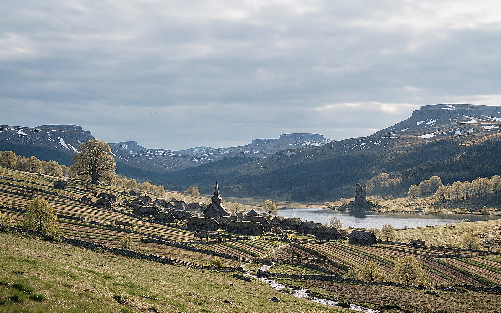
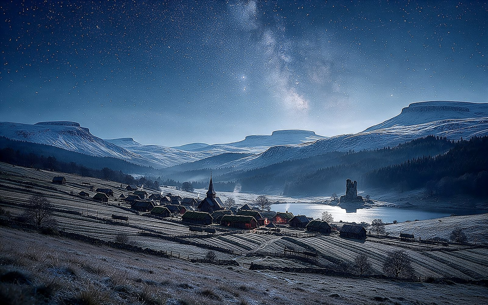

# Time Wallpaper · 时间壁纸

> A macOS menu-bar app that changes your desktop wallpaper according to **the real position of the sun, live weather, season and moon phase** — with 48 hand-crafted Nordic-village wallpapers.

**English** · [中文](README.zh-CN.md)




---

## What it does

Every 5 minutes the app asks two questions and picks an image:

1. **Where is the sun?** — solar altitude at your coordinates decides the phase:
   `pre-dawn → dawn → sunrise → morning → midday → afternoon → dusk → blue hour → night`
2. **What is the weather doing?** — live cloud cover, precipitation, visibility decide sunny / rain / snow / fog, plus special events (rainbow after rain at dusk, sea of clouds at dawn, thunderstorms).

On top of that:

- **Astronomical seasons** (solstices & equinoxes, not calendar months) pick season-tinted images.
- **Moon phase** decides whether a moonlit image is used at all (new moon → stars only).
- **Automatic location** via IP geolocation — no permission prompt, follows you when you travel (refreshed every 6 hours).
- **Southern hemisphere aware** — seasons are flipped below the equator.
- **Bilingual UI** — 中文 / English, follows your system language, switchable from the menu.

No dependencies. One Swift file, one bundled wallpaper folder.

---

## Wallpapers

48 images, 2560×1600, generated with an image model and then corrected against physics
(the sun's real altitude, snow distribution by slope aspect, only deciduous trees turning colour, etc.).

| Group | Count | Examples |
|---|---|---|
| Time of day | 9 | `predawn`, `sunrise`, `dusk`, `bluehour`, `night` |
| Weather (season-agnostic fallback) | 4 | `w_clear`, `w_rain`, `w_fog`, `w_snow` |
| Season × time/weather | 24 | `se_autumn_rain`, `se_winter_night`, `se_spring_dusk` |
| Season (daytime) | 4 | `se_spring`, `se_summer`, `se_autumn`, `se_winter` |
| Special events | 7 | `wx_rainbow`, `wx_cloudsea`, `wx_storm`, `cu_harvest`, `cu_midsummer`, `sk_aurora`, `sk_moonrise` |

Naming: `se_<season>_<type>` where season ∈ spring/summer/autumn/winter and type ∈ rain/fog/snow/night/predawn/dusk.
Missing seasonal variants automatically fall back to the generic image.

---

## Install

### Requirements

- macOS 13 or newer
- Xcode Command Line Tools (`xcode-select --install`) only if you build from source

### Build & run

```bash
git clone https://github.com/zhqowo/time-wallpaper.git
cd time-wallpaper

# 1. put the wallpapers where the app looks for them
mkdir -p ~/Pictures/TimeWallpaper
cp wallpapers/*.jpg ~/Pictures/TimeWallpaper/

# 2. build the app
cd app && ./build.sh

# 3. launch (a ⛰ icon appears in the menu bar)
open TimeWallpaper.app
```

### Run at login

Create `~/Library/LaunchAgents/local.zhqowo.timewallpaper.app.plist`:

```xml
<?xml version="1.0" encoding="UTF-8"?>
<!DOCTYPE plist PUBLIC "-//Apple//DTD PLIST 1.0//EN" "http://www.apple.com/DTDs/PropertyList-1.0.dtd">
<plist version="1.0"><dict>
  <key>Label</key><string>local.zhqowo.timewallpaper.app</string>
  <key>ProgramArguments</key>
  <array><string>/usr/bin/open</string><string>-a</string><string>REPLACE_WITH_PATH_TO/TimeWallpaper.app</string></array>
  <key>RunAtLoad</key><true/>
</dict></plist>
```

```bash
launchctl bootstrap gui/$(id -u) ~/Library/LaunchAgents/local.zhqowo.timewallpaper.app.plist
```

---

## Usage

Click the ⛰ icon in the menu bar:

| Item | Meaning |
|---|---|
| Now / Weather / Astronomy / Location | current phase, live weather, sunrise-sunset-daylight-moon, detected city |
| **Refresh now** ⌘R | re-fetch weather immediately |
| **Re-detect location** ⌘L | re-run IP geolocation |
| **Auto switch** | toggle automatic switching |
| **Language** | switch 中文 / English |
| **Lock to…** | pin one wallpaper permanently |
| **Unlock** | back to automatic |
| **Open image folder** | reveal the wallpaper folder |

The status icon itself reflects the state: rain cloud, snow cloud, fog, sun, moon, aurora sparkles, pin when locked.

---

## Custom wallpapers

Point the app at any folder:

```bash
defaults write local.zhqowo.timewallpaper WallDir -string "~/Pictures/MyWallpapers"
```

Any `.png` or `.jpg` named like the table above will be used; unknown files are ignored.
Restart the app afterwards.

---

## Physics used

Solar position uses the NOAA simplified algorithm (declination + equation of time + hour angle).
Twilight boundaries are the standard ones: sunrise at **−0.833°**, golden hour **0…6°**,
civil twilight **−6°**, astronomical twilight **−18°**.

For Ningbo (29.87 °N) that gives:

| | Summer solstice | Winter solstice |
|---|---|---|
| Noon altitude | 83.6° | 36.7° |
| Shadow length / object height | 0.11 | 1.34 |
| Daylight | 14 h 05 m | 10 h 13 m |

Aurora only appears in aurora season (Nov–Mar) on clear nights; the moon image requires >35 % illumination.

---

## Credits

- Code: MIT
- Wallpapers: generated with ByteDance **doubao-seedream-5.0-pro**, then physically corrected; free to use under the same licence
- Nothing is sent anywhere except: IP geolocation (`ipwho.is`) and weather (`open-meteo.com`). No accounts, no analytics.
