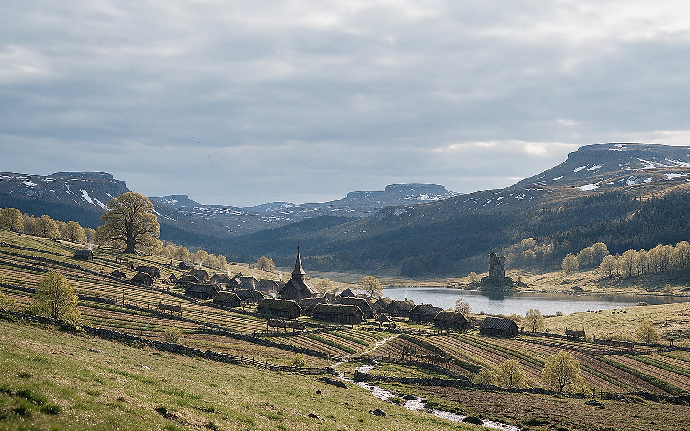
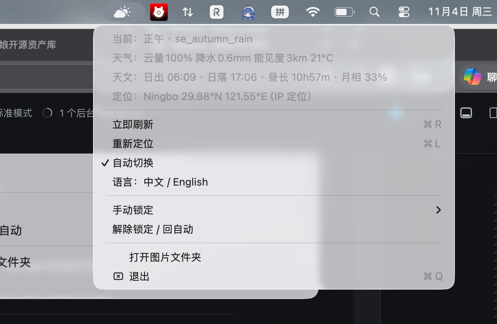

# 时间壁纸 · Time Wallpaper

> 一个挂在 macOS 菜单栏的小 App：**按太阳的实时高度角、真实天气、天文季节与月相**自动更换桌面壁纸，自带 48 张北欧村落主题壁纸。

[](https://github.com/zhqowo/time-wallpaper/actions/workflows/build.yml)

[English](README.md) · **中文**




---

## 它是怎么工作的

每 5 分钟问两个问题：

1. **太阳在哪？** —— 按你所在坐标的太阳高度角划分时段：
   `凌晨 → 黎明 → 日出 → 上午 → 正午 → 下午 → 黄昏 → 暮色 → 夜`
2. **天气怎样？** —— 实时云量、降水、能见度决定晴 / 雨 / 雪 / 雾，另有特殊事件（雨后黄昏出彩虹、黎明晴出云海、雷暴）。

在此之上：

- **天文季节**（用二分二至划分，不是自然月）决定季节色调
- **月相**决定夜里要不要放“月光”那张（新月夜只留星空）
- **自动定位**：IP 定位，不需要授权弹窗；出门旅行会自动跟过去（每 6 小时刷新）
- **南半球适配**：赤道以南季节自动翻转
- **中英双语**：跟随系统语言，菜单里可一键切换

零依赖，一个 Swift 文件 + 一个壁纸目录。

---

## 壁纸

48 张，2560×1600。全部由图像模型生成，并按物理常识逐张修正
（太阳高度角、雪按坡向分布、只有落叶树变色 …… 这些细节都改过）。

| 分组 | 张数 | 例子 |
|---|---|---|
| 时段 | 9 | `predawn`、`sunrise`、`dusk`、`bluehour`、`night` |
| 天气（不分季节的兜底） | 4 | `w_clear`、`w_rain`、`w_fog`、`w_snow` |
| 季节 × 时段/天气 | 24 | `se_autumn_rain`、`se_winter_night`、`se_spring_dusk` |
| 季节（白天） | 4 | `se_spring`、`se_summer`、`se_autumn`、`se_winter` |
| 特殊事件 | 7 | `wx_rainbow`、`wx_cloudsea`、`wx_storm`、`cu_harvest`、`cu_midsummer`、`sk_aurora`、`sk_moonrise` |

命名规则：`se_<季节>_<类型>`，季节 ∈ spring/summer/autumn/winter，类型 ∈ rain/fog/snow/night/predawn/dusk。
缺季节图时自动回退到通用图。

---

## 安装

### 环境

- macOS 13 及以上
- 只有从源码编译时才需要 Xcode Command Line Tools（`xcode-select --install`）

### 编译并运行

```bash
git clone https://github.com/zhqowo/time-wallpaper.git
cd time-wallpaper

# 1. 把壁纸放到 App 会去找的位置
mkdir -p ~/Pictures/TimeWallpaper
cp wallpapers/*.jpg ~/Pictures/TimeWallpaper/

# 2. 编译
cd app && ./build.sh

# 3. 启动（菜单栏出现一个 ⛰ 图标）
open TimeWallpaper.app
```

### 开机自启

新建 `~/Library/LaunchAgents/local.zhqowo.timewallpaper.app.plist`：

```xml
<?xml version="1.0" encoding="UTF-8"?>
<!DOCTYPE plist PUBLIC "-//Apple//DTD PLIST 1.0//EN" "http://www.apple.com/DTDs/PropertyList-1.0.dtd">
<plist version="1.0"><dict>
  <key>Label</key><string>local.zhqowo.timewallpaper.app</string>
  <key>ProgramArguments</key>
  <array><string>/usr/bin/open</string><string>-a</string><string>替换成/TimeWallpaper.app</string></array>
  <key>RunAtLoad</key><true/>
</dict></plist>
```

```bash
launchctl bootstrap gui/$(id -u) ~/Library/LaunchAgents/local.zhqowo.timewallpaper.app.plist
```

---



## 用法

点菜单栏的 ⛰ 图标：

| 菜单项 | 含义 |
|---|---|
| 当前 / 天气 / 天文 / 定位 | 当前时段、实时天气、日出日落昼长月相、定位到的城市 |
| **立即刷新** ⌘R | 马上重新拉天气 |
| **重新定位** ⌘L | 重新跑一次 IP 定位 |
| **自动切换** | 开关自动换图 |
| **语言** | 中文 / English 切换 |
| **手动锁定** | 固定某一张 |
| **解除锁定** | 回到自动 |
| **打开图片文件夹** | 打开壁纸目录 |

状态图标本身会变：雨云、雪云、雾、太阳、月亮、极光、锁定时显示图钉。

---

## 换成自己的图

把 App 指向任意目录：

```bash
defaults write local.zhqowo.timewallpaper WallDir -string "~/Pictures/我的壁纸"
```

目录里按上表命名的 `.png` / `.jpg` 会被使用，其它文件忽略。改完重启 App。

---

## 用到的物理

太阳位置用 NOAA 简化算法（赤纬 + 均时差 + 时角）。
晨昏分界用标准定义：日出 **−0.833°**、黄金时刻 **0…6°**、民用晨昏 **−6°**、天文晨昏 **−18°**。

以宁波（29.87°N）为例：

| | 夏至 | 冬至 |
|---|---|---|
| 正午太阳高度 | 83.6° | 36.7° |
| 影子长度 / 物体高度 | 0.11 | 1.34 |
| 昼长 | 14 小时 05 分 | 10 小时 13 分 |

极光只在极光季（11–3 月）晴朗夜出现；月光那张要求月面照度 > 35%。

---

## 说明

- 代码 MIT；壁纸由字节跳动 **doubao-seedream-5.0-pro** 生成后人工校正，同样开放使用
- 只访问两个外部服务：IP 定位（`ipwho.is`）与天气（`open-meteo.com`）。没有账号、没有埋点。
